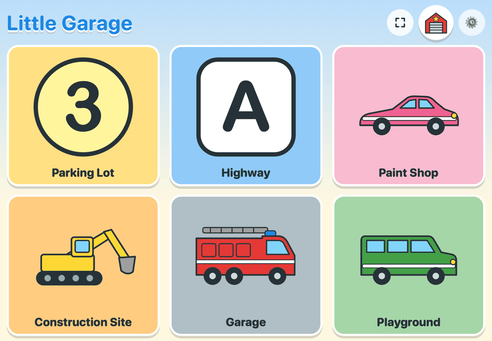
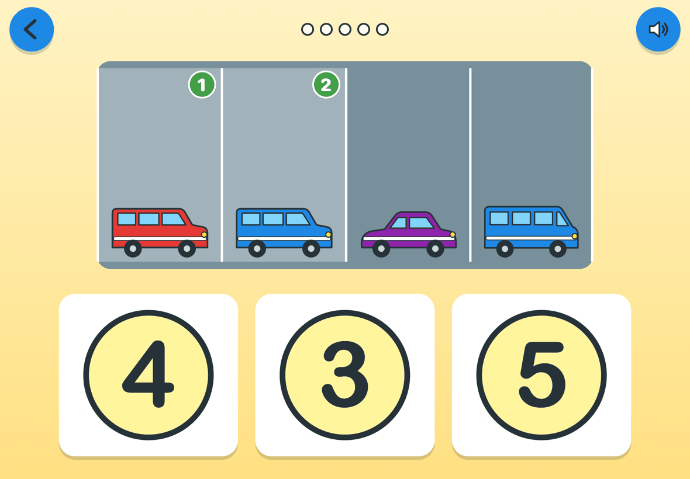
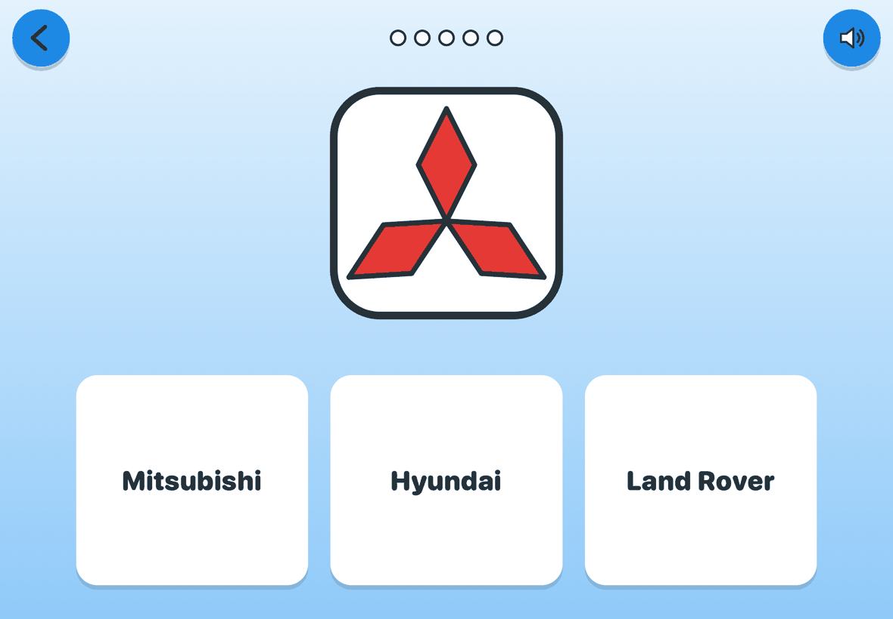
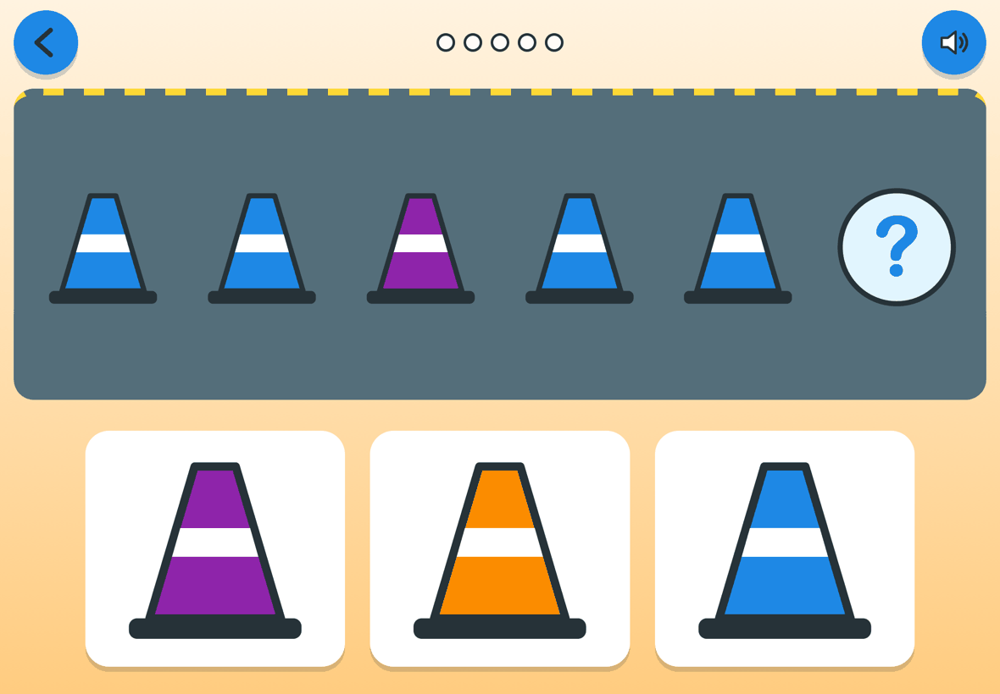
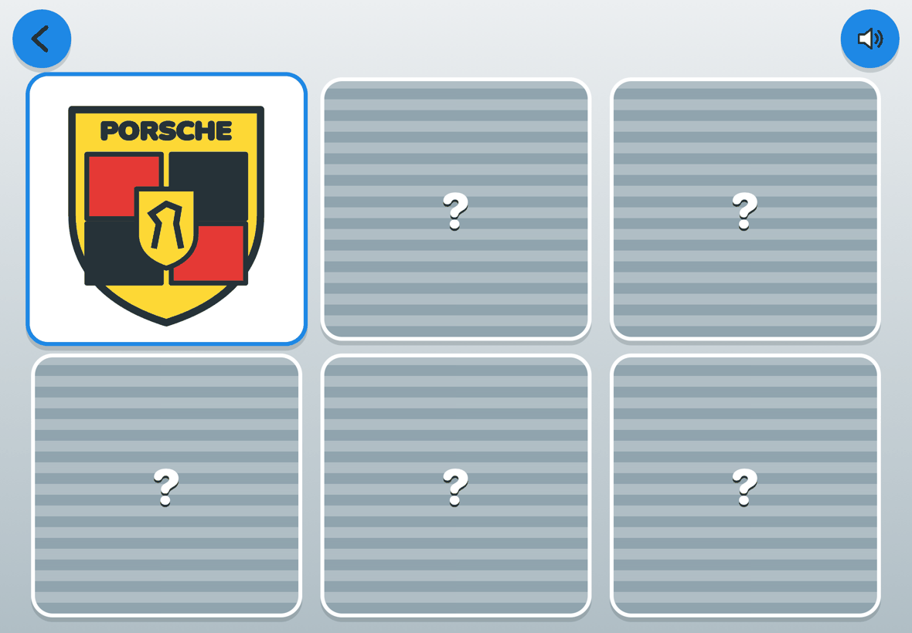
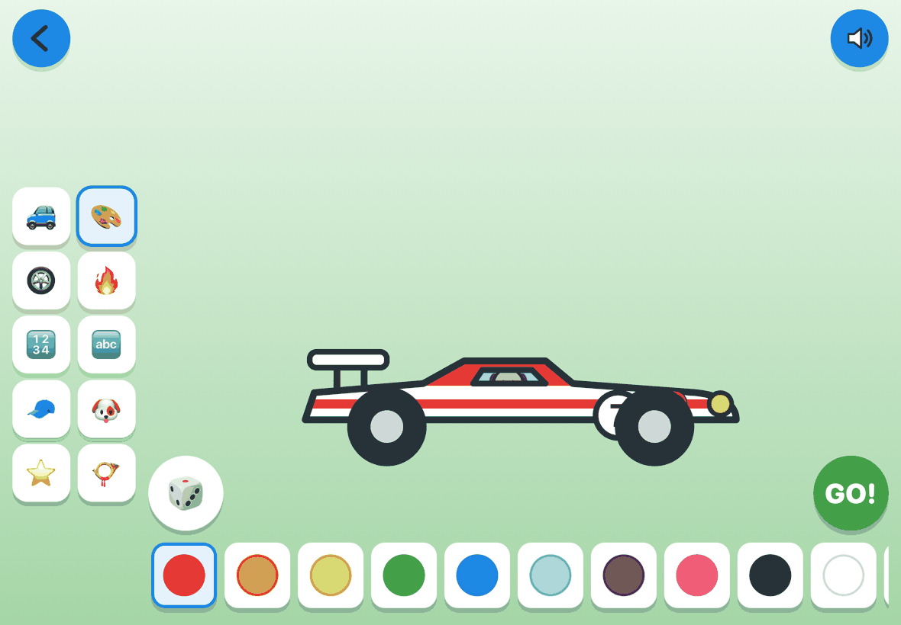
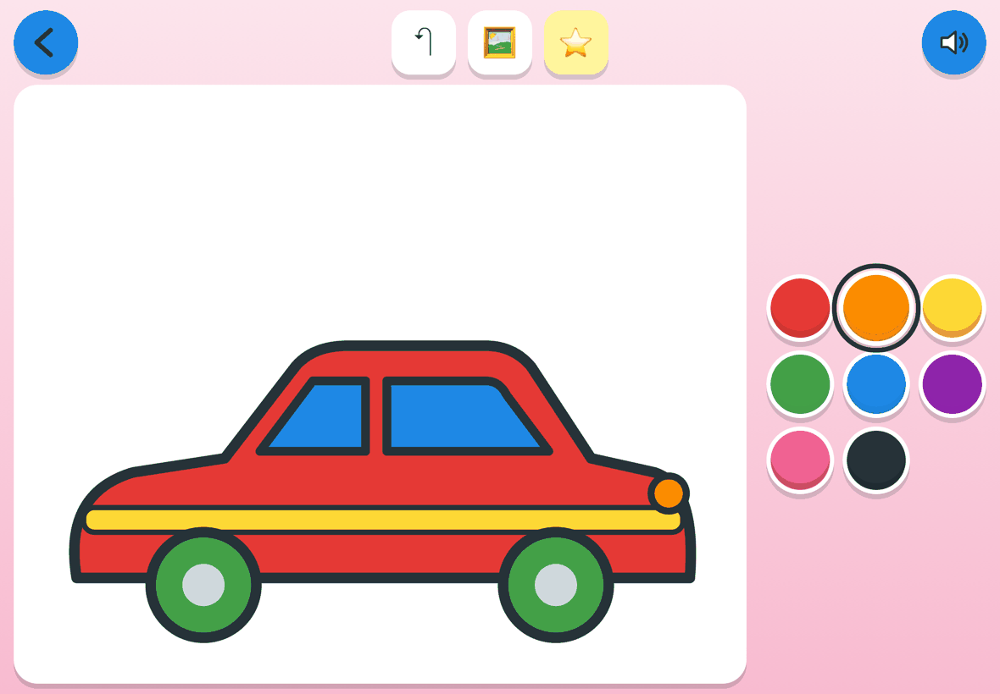
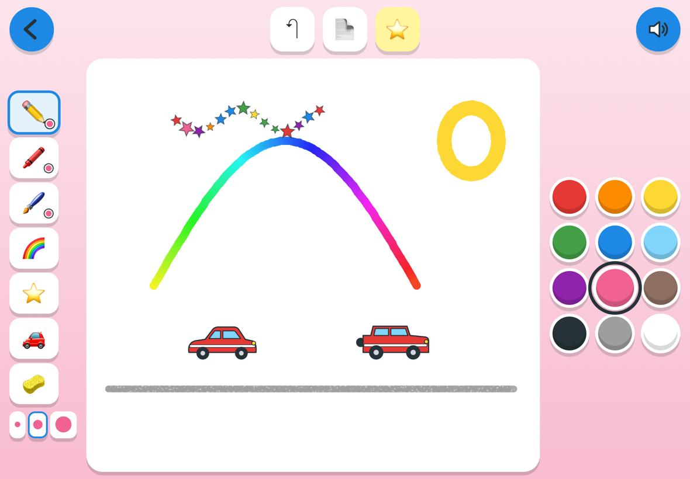
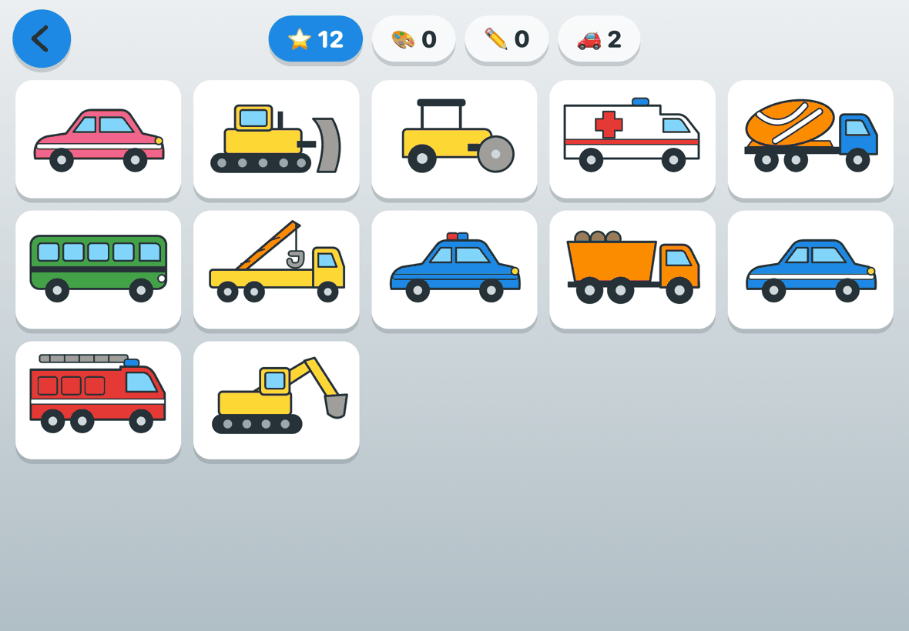

# 🚗 Little Garage

[](https://github.com/jollyjoker992/little-garage/actions/workflows/ci.yml) [](LICENSE)

A car-themed learning game for 3–4 year olds: **numbers, letters, colors, shapes, logic, memory and listening**, told with car brands and construction vehicles. Spoken in **English or Vietnamese**, made for the **iPad**, works **offline**, deploys to **Cloudflare Pages**.

- 6 zones, **26 playable games** (5 more designed, 4 turned off), 3 adaptive levels each
- Paint Shop coloring book for every vehicle and brand logo, plus a free **Drawing Board** (pencil, crayon, brush, rainbow, stars, stickers, eraser)
- Stickers, saved paintings and built cars in "My Garage"
- ⛶ full screen: tapping ▶ goes full screen; the ⛶ button on the home screen toggles it (iPhone: use Add to Home Screen)
- Grown-ups settings: tap ⚙️ on the home screen (language, voice speed, levels, hide games, session limit)

## Screenshots
On an iPad in landscape. Try it at [little-garage.pages.dev](https://little-garage.pages.dev).



| | |
|---|---|
|  |  |
| **Count the Cars**: tap each car to count it, then pick the number | **Read the Brand**: which name goes with this logo? |
|  |  |
| **Pattern Road**: which cone comes next? | **Brand Memory**: flip cards to find the pairs |
|  |  |
| **Build a Car**: body, paint, stripes, wheels, number, driver | **Paint Shop**: tap a color, then tap part of the car |
|  |  |
| **Drawing Board**: rainbow, stars and car stamps | **My Garage**: stickers, paintings, drawings and built cars |

Needs **Node 24+ and npm 11+** (`nvm use` reads `.nvmrc`).

```sh
npm install
npm run dev -- --host   # open http://<your-mac-ip>:5173 on the iPad
npm test                # generators, translations, art regions, adaptive levels
npm run lint            # ESLint (CI also runs typecheck, test and build)
npm run build           # → dist/
```

| Doc | What's in it |
|---|---|
| [docs/GAME_DESIGN.md](docs/GAME_DESIGN.md) | Design rules, zones, every game × level |
| [docs/SCRIPTS.md](docs/SCRIPTS.md) | Every spoken line, EN + VI (generated) |
| [docs/CONTENT_GUIDE.md](docs/CONTENT_GUIDE.md) | Add a brand / vehicle / game / translation / recording |
| [docs/ARCHITECTURE.md](docs/ARCHITECTURE.md) | Code map and contracts |
| [docs/DEPLOY.md](docs/DEPLOY.md) | Cloudflare Pages + iPad install |

## License
The code and the original artwork are released under the [MIT License](LICENSE).

## Trademarks
Car brand names and logos (Toyota, BMW, Ford, VinFast and the others in `src/content/brands.ts`) are trademarks of their owners. They are **not** covered by the MIT License, and this project is not affiliated with or endorsed by any of them. The badges in `src/art/logos.tsx` are simplified, kid-style drawings used only so a young child can recognize and name the brands they see on the street.

If you build on this project, the MIT License gives you no rights to those marks; check what is allowed where you publish, or remove the brand content (see [docs/CONTENT_GUIDE.md](docs/CONTENT_GUIDE.md#about-the-logos)). If you represent a brand and want it removed, please open an issue and it will be taken out.
